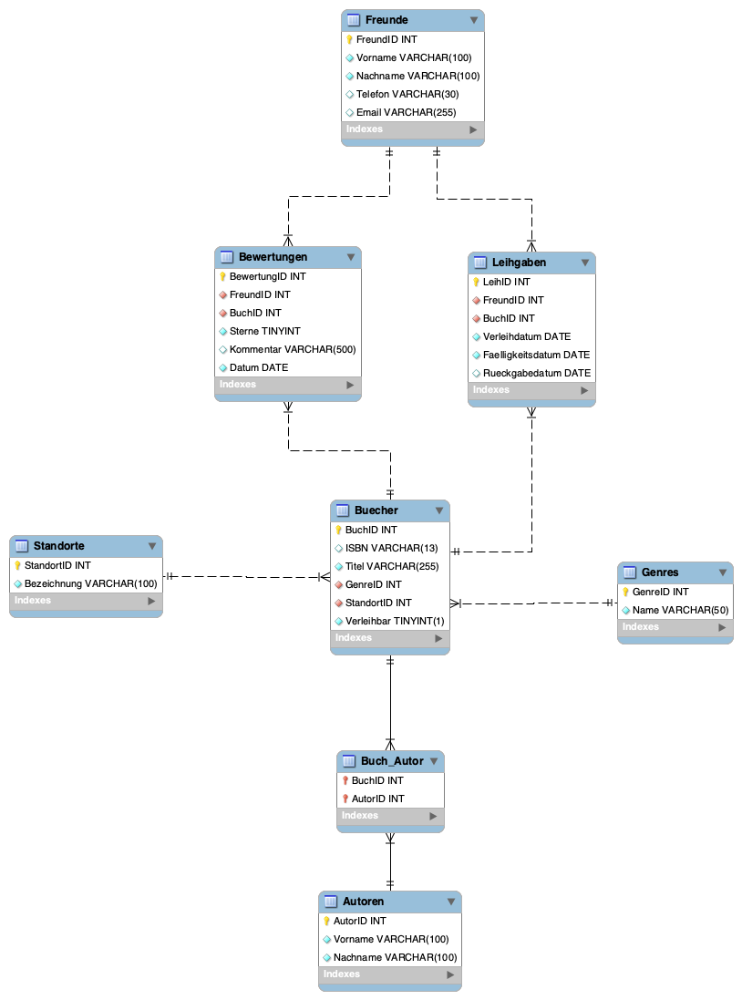

# 📚 Lianes Bibliothek

Eine kleine App, mit der Liane ihre private Büchersammlung verwalten kann: Wer hat welches Buch, seit wann, und wann ist es fällig? Dazu gibt es Kontaktdaten der Freunde, Bewertungen und ein Bücherregal mit Covern.

Projekt der Fallstudie "Liane's Library" im Data-Analytics-Bootcamp, erstellt von Navid Modir Khazeni.

## Funktionen

- **Bücher:** Bücherregal mit Covern, Tabelle, Filter nach Status und Genre, Bücher hinzufügen und löschen
- **Automatischer Status:** verfügbar, verliehen, überfällig oder Eigengebrauch (wird bei jeder Abfrage aus den Leihdaten berechnet)
- **Freunde:** Liste mit Telefon, E-Mail und den Büchern, die sie gerade haben; Freunde hinzufügen und löschen
- **Leihgaben und Rückgaben** eintragen (ein Buch kann nicht doppelt verliehen werden)
- **Bewertungen:** Freunde bewerten Bücher mit 1 bis 5 Sternen und einem Kommentar
- Die Leihhistorie bleibt erhalten: Bücher und Freunde mit Leihgaben lassen sich nicht löschen

## Technik

MySQL, Python 3.12, SQLAlchemy mit PyMySQL, pandas und Streamlit. Die Python-Umgebung wird mit conda verwaltet.

## Datenbank

Die Datenbank `lianes_bibliothek` besteht aus acht Tabellen in dritter Normalform, dazu die View `v_buchuebersicht`, die den Status berechnet.

| Tabelle | Inhalt |
|---|---|
| `Buecher` | Titel, ISBN, Genre, Standort, ob verleihbar |
| `Autoren` und `Buch_Autor` | Autoren und die Zuordnung zu Büchern (ein Buch kann mehrere Autoren haben) |
| `Genres` und `Standorte` | Nachschlagetabellen |
| `Freunde` | Name, Telefon, E-Mail |
| `Leihgaben` | wer hat wann welches Buch geliehen, Fälligkeit, Rückgabe |
| `Bewertungen` | Sterne und Kommentar eines Freundes zu einem Buch |



## Projektstruktur

```
lianes-bibliothek-app/
├── .streamlit/config.toml   Design der App (helles Theme)
├── dokumente/               ER-Diagramm
├── sql/                     Datenbank: Struktur und Beispieldaten
├── src/
│   ├── app.py               die Streamlit-App
│   ├── crud.py              Funktionen für die Datenbank (Lesen, Anlegen, Ändern, Löschen)
│   └── stil.py              Aussehen, Cover und Hintergrund
├── environment.yml          Python-Umgebung
└── README.md
```

## Installation

Voraussetzungen: ein laufender MySQL-Server (mit MySQL Workbench) und conda (zum Beispiel Miniforge).

1. **Projekt herunterladen** (von GitHub als ZIP oder mit `git clone`) und im Terminal in den Projektordner wechseln.
2. **Python-Umgebung anlegen:**
   ```
   conda env create -f environment.yml
   conda activate lianes-lib-env
   ```
3. **Datenbank aufbauen:** In der MySQL Workbench zuerst die Datei mit der Struktur aus dem Ordner `sql` ausführen, danach die Datei mit den Beispieldaten.
4. **App starten:**
   ```
   streamlit run src/app.py
   ```
   Im Browser das MySQL-Passwort eingeben. Als Benutzer wird `root` auf `localhost` (Port 3306) verwendet. Wer einen anderen Benutzer hat, ändert in `src/crud.py` die Zeile `username="root"`.

## Hinweise

- Das Passwort steht nirgends im Code, es wird beim Anmelden eingegeben.
- Die Cover werden beim ersten Öffnen der Bücherübersicht über Google Books und Open Library gesucht (Internet nötig) und in `src/cover-cache-v2.json` gemerkt. Wird kein Cover gefunden, zeichnet die App eines.
- Optional: Ein eigenes Foto als `src/hintergrund.jpg` ablegen, dann nutzt die App es als Hintergrund.
- Alle Beispieldaten (Freunde, Telefonnummern, E-Mails, ISBNs, Leihgaben) sind erfunden. Weil der Status vom heutigen Datum abhängt, werden die Beispiel-Leihgaben ab Dezember 2026 nach und nach "überfällig".

## Ausblick

Kontaktdaten von Freunden ändern, mehrere Exemplare desselben Buchs, Erinnerungen per E-Mail bei überfälligen Büchern.